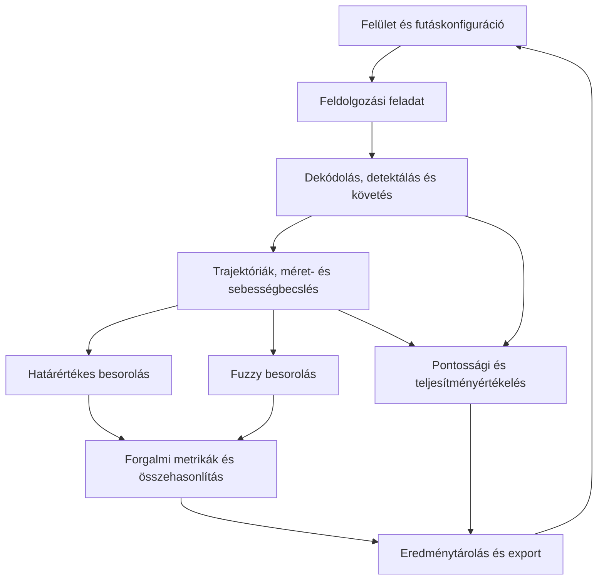

# Közúti forgalom automatikus elemzése videófelvételek alapján

## 1. Szereplők és jogosultságok

| Szerep      | Igény                                                          | Felelősség / hozzáférés                                                             |
| ----------- | -------------------------------------------------------------- | ----------------------------------------------------------------------------------- |
| Felhasználó | Közúti videók feldolgozása és a forgalmi jellemzők megismerése | Videót választ, elindítja a feldolgozást, megtekinti és exportálja az eredményeket. |
## 2. Use case-ek / user storyk

### Videó feldolgozása és forgalmi mutatók előállítása

- **Szereplő:** Felhasználó
- **Előfeltétel:** Rendelkezésre áll egy támogatott formátumú, rögzített kamerával készített közúti videó.
- **Fő folyamat:**
  1. A szereplő kiválasztja a videót.
  2. A szereplő elindítja a feldolgozást.
  3. A rendszer detektálja és időben követi a járműveket, trajektóriákat képez, méretet és sebességet becsül.
  4. A rendszer elvégzi a határértékes és a fuzzy kategorizálást, majd kiszámítja a forgalmi mutatókat.
  5. A rendszer megjeleníti a feldolgozott képkockákat, a követési azonosítókat, trajektóriákat, diagramokat és összesítő táblázatokat.
- **Alternatív / hibafolyamatok:** Nem olvasható videó vagy hibás konfiguráció esetén a rendszer érthető hibaüzenetet ad.
- **Utófeltétel:** Az elemzés eredménye és a hozzá tartozó konfiguráció visszakereshető.

## 3. Funkcionális követelmények

| Követelmény                                                                | Elfogadási kritérium                                                                                                                     | Prioritás  |
| -------------------------------------------------------------------------- | ---------------------------------------------------------------------------------------------------------------------------------------- | ---------- |
| A rendszer videót fogad és ellenőrzi a bemenetet.                          | Amennyiben a fileformátum megfelel és olvasható akkor a rendszer betölti.                                                                | Kötelező   |
| A rendszer járműveket detektál.                                            | A tesztvideón képkockánként előállnak a befoglaló téglalapok a detektáktált jarművek körül.                                              | Kötelező   |
| A rendszer járműtrajektóriákat állít elő                                   | Minden követett járműhöz rendezett időbélyeg–pozíció sorozat tartozik.                                                                   | Kötelező   |
| A rendszer kezeli a rövid takarásokat és a követési megszakadásokat.       | A konfigurált kiesési időn belüli visszatérésnél megkísérli az azonosító megtartását.                                                    | Kötelező   |
| A rendszer méretet és sebességet becsül a trajektóriákhoz.                 | A tesztvideón detektált járművekhez sebességet és méretosztályt rendel.                                                                  | Kötelező   |
| A rendszer dokumentált méret- és sebességalapú merev kategorizálást végez. | Érvényes becsléseknél a határértékek és a határon álló értékek kezelésének szabálya alapján minden jármű pontosan egy kategóriába kerül. | Kötelező   |
| A rendszer kategóriánként számlálja a járműveket.                          | A tesztvideon megjelenő járművek kategóriánkként megszámlálásra kerülnek.                                                                | Kötelező   |
| A rendszer átlagos és eloszlásalapú sebességi mutatókat képez.             | Kategóriánként rendelkezésre áll az érvényes minta mérete, az átlag, és a medián.                                                        | Kötelező   |
| A rendszer forgalomintenzitást számít.                                     | Áthaladásszám és megfigyelési idő alapján forgalomintenzitást számol.                                                                    | Kötelező   |
| A rendszer összehasonlítja a merev és fuzzy besorolást.                    | Ugyanazon trajektóriák és időablakok mellett táblázat vagy diagram mutatja a kategóriánkénti mérések eltérését.                          | Kötelező   |
| A rendszer legalább két detektálási vagy követési megközelítést értékel.   | Azonos tesztvideókon elkészül a pontosságot, identitáscserét, feldolgozási sebességet és memóriaigényt tartalmazó összehasonlítás.       | Kötelező   |
| A rendszer torlódási vagy rendellenes eseményeket jelezhet.                | A később meghatározott eseményszabályok alapján az esemény időpontja és érintett szakasza visszakereshető.                               | Lehetséges |
| A rendszer több kamera adatait együttesen kezelheti.                       | Külön specifikált időszinkronizálás és kamerák közötti megfeleltetés mellett összesített eredmény készül.                                | Lehetséges |

Prioritás: **Kötelező** = a végtermékhez szükséges; **Ajánlott** = fontos; **Lehetséges** = idő esetén opcionális.

## 4. Üzleti szabályok és korlátok

| Szabály vagy korlát                                                                                                                                                      | Indoklás                                                                                             |
| ------------------------------------------------------------------------------------------------------------------------------------------------------------------------ | ---------------------------------------------------------------------------------------------------- |
| Az alapváltozat rögzített kamerával készült videók utólagos elemzésére készül.                                                                                           | A mozgó kamera külön kameramozgás-kompenzációt igényel; valós idejű feldolgozás nem alapkövetelmény. |
| A méretbecsléshez külön dokumentált geometriai feltevés vagy méretmodell szükséges.                                                                                      | A perspektíva, a jármű magassága, iránya és takarása befolyásolja a becslést.                        |
| Egy követési azonosító ugyanazon számlálási eseményhez egyszer járulhat hozzá; bizonytalan töredékeket csak dokumentált megfeleltetési szabállyal szabad összekapcsolni. | Az identitásváltásból eredő kettős számlálás kockázata ellenőrizhető marad.                          |
| A hiányzó sebesség vagy méret nem helyettesíthető nullával; az összes áthaladás és a kategorizálható részhalmaz külön szerepel.                                          | Megakadályozza a torz átlagokat és jelzi az adatlefedettséget.                                       |

## 5. Felhasználói felület és munkafolyamat

A felület négy fő nézetből áll:

1. **Videó és beállítások:** videóválasztás, előnézet, kalibráció, kategóriakonfiguráció és időablak megadása.
2. **Feldolgozás:** futási állapot, előrehaladás, hibák és figyelmeztetések.
3. **Eredmények:** videó és rárajzolt detektálások/trajektóriák, járművenkénti adatok, kategóriánkénti darabszám, sebességeloszlás és forgalomintenzitás. A fizikai és képi egységű értékek, valamint a merev és fuzzy eredmények jól elkülönülnek.

A felhasználó a videó kiválasztásától a beállításokon keresztül jut a feldolgozás indításához. Az eredményekből visszaléphet a beállításokhoz és új konfigurációval új futást készíthet. A korábbi futás eredménye megmarad, így a változatok összehasonlíthatók. Minden eredménynél látható a vizsgált időszak, a kalibráció állapota és a hiányzó vagy bizonytalan becslések aránya.

## 6. Nem funkcionális követelmények

| Követelmény                                                                                                          | Ellenőrzés módja                                                                                                |
| -------------------------------------------------------------------------------------------------------------------- | --------------------------------------------------------------------------------------------------------------- |
| A felhasználó a felületen található útmutatás alapján el tud indítani egy elemzést és meg tudja találni az exportot. | Megfigyeléses használhatósági próba egy, a fejlesztésben részt nem vevő felhasználóval.                         |
| Egy kísérlet konfigurációja reprodukálható.                                                                          | Ugyanazon bemeneti paraméterek mellett két futás összevetése; nem determinisztikus eltérések dokumentálása.     |
| A hibás bemenet és a feldolgozási kivétel nem törli a korábbi futások eredményét.                                    | Sérült videóval, érvénytelen kalibrációval és szimulált írási hibával végzett hibakezelési teszt.               |
| A mentett aggregált eredmények helyi tárolóból normál tesztkörülmények között 2 másodpercen belül megjelennek.       | Öt mentett tesztfutás megnyitásának mérése a dokumentált referenciahardveren; a videó dekódolása külön mérendő. |

## 7. Nyitott kérdések és kockázatok

| Kérdés / kockázat                                                              | Hatás                                                              | Felelős  | Feloldás / döntés                                                                                                                         |
| ------------------------------------------------------------------------------ | ------------------------------------------------------------------ | -------- | ----------------------------------------------------------------------------------------------------------------------------------------- |
| Mely publikus adathalmaz biztosít megfelelő videókat és követési annotációkat? | Meghatározza a mérhető pontosságot és a jelenetek lefedettségét.   | Hallgató | Jelöltek felkutatása, hozzáférés és felhasználási feltételek ellenőrzése, dokumentált beszerzés; szükség esetén kézi annotálás.           |
| Rendelkezésre áll fizikai sebesség- és méretreferencia?                        | Nélküle a fizikai becslések pontossága nem igazolható közvetlenül. | Hallgató | Kalibrálható referenciajelenet vagy ismert geometria és sebességadat keresése; hiány esetén a validálás korlátjának egyértelmű rögzítése. |
| Mely méretjellemző becsülhető megbízhatóan?                                    | Befolyásolja a kategóriák értelmét és stabilitását.                | Hallgató | Járműhossz, szélesség vagy dokumentált méretproxy prototípusának vizsgálata; a kiválasztott jellemző és feltevések rögzítése.             |
| A takarás és identitáscsere kettős számlálást okozhat.                         | Torzítja a járműszámot és a forgalomintenzitást.                   | Hallgató | Két követési módszer összevetése, számlálási állapot megőrzése, töredékek és bizonytalanságok kimutatása.                                 |
| A perspektíva, megvilágítás és kis képi járműméret növeli a hibát.             | Rontja a detektálást és a méret-/sebességbecslést.                 | Hallgató | Feltételenkénti értékelés, megfelelő elemzési terület és kalibráció, hibaterjedés vizsgálata.                                             |
| Milyen hardver érhető el, szükséges-e GPU?                                     | Meghatározza a futásidőt és a modell méretét.                      | Hallgató | CPU/GPU próbamérés; referenciahardver kijelölése és könnyebb modell vizsgálata.                                                           |

## 8. Kezdeti technikai javaslat

### Javasolt megoldás

A javasolt rendszer moduláris, Python-alapú videófeldolgozó alkalmazás helyi webes felülettel. A feldolgozó lánc a bemeneti videó ellenőrzésétől a képkockák dekódolásán, a detektáláson és követésen keresztül jut a trajektóriákhoz, a kalibrált becslésekhez, a kategorizáláshoz és a statisztikákhoz. A felület a konfigurációt és az eredmények megtekintését biztosítja; a hosszú feldolgozási futások a felület újrarajzolásától elkülönített feladatként működnek.

A detektor, követő, kalibrációs eljárás és kategorizáló cserélhető komponensként készül. Első összehasonlításként ugyanaz a detektor két eltérő követővel használható, így a követő hatása elkülöníthető. A végleges modellek és csomagverziók kiválasztása prototípusmérés, használhatóság és felhasználási feltételek ellenőrzése után történik.

### Technológiai irány

| Terület                     | Jelölt technológia / megközelítés                                   | Megfontolás oka                                                       | Nyitott kérdés / kockázat                                                       |
| --------------------------- | ------------------------------------------------------------------- | --------------------------------------------------------------------- | ------------------------------------------------------------------------------- |
| Feldolgozó alkalmazás       | Python                                                              | Egységes környezet a képfeldolgozás, numerikus számítások számára.    | Függőségek és hardverkompatibilitás rögzítése.                                  |
| Videódekódolás és geometria | OpenCV; szükség esetén külön időbélyeg-kezelő dekóder               | Képi műveletek, kijelölések, perspektívatranszformáció.               | Változó képkockasebesség és kodektámogatás ellenőrzése.                         |
| Járműdetektálás             | Előtanított YOLO-családba tartozó modell, PyTorch-alapú futtatással | Kiindulási alap a járművek képkockánkénti detektálásához.             | Konkrét modell, licenc, pontosság és futásidő vizsgálandó.                      |
| Követés                     | ByteTrack és SORT jelöltként                                        | Két elkülönülő követési megközelítés azonos detektorral összevethető. | Takarásos jelenetek, identitáscserék és hozzáférhető implementációk vizsgálata. |
| Statisztikák                | NumPy,                                                              | Trajektóriaadatok aggregálása és exportja.                            | Súlyozott percentilisek és hiányzó adatok egységes kezelése.                    |
| Diagramok                   | Plotly                                                              | Idősorok, eloszlások és összehasonlítások megjelenítése.              | Nagy adatmennyiséghez előaggregálás szükséges lehet.                            |
| Adattárolás                 | SQLite a futásmetaadatokhoz; CSV/JSON a részletes eredményekhez     | Helyi, könnyen menthető és visszakereshető elemzések.                 | Trajektóriaadatok mérete és fájl–adatbázis konzisztencia.                       |

### Kezdeti architektúravázlat

### Megvalósíthatóság és technikai kockázatok

| Kockázat / feltételezés                               | A 2. félévre tervezett validáció                                                                 | Tartalék megközelítés                                                                                    |
| ----------------------------------------------------- | ------------------------------------------------------------------------------------------------ | -------------------------------------------------------------------------------------------------------- |
| A rendelkezésre álló videó kalibrálható.              | Ismert útsíkbeli távolságokkal perspektívatranszformáció és hibavizsgálat.                       | Kalibrálható tesztjelenet választása; kalibrálatlan videón csak képi egységű előnézeti elemzés.          |
| A választott méretjellemző megfelelően becsülhető.    | Ismert méretű referenciajárművek vagy hiteles annotációk alapján hibamérés.                      | Más dokumentált méretjellemző alkalmazása; a fizikai pontosság igazolásának korlátait fenn kell tartani. |
