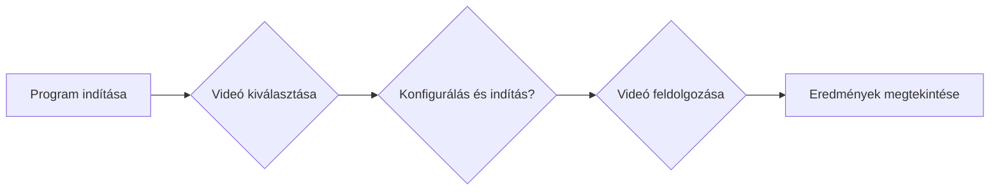

<!--@slide Title-->

<!-- 5xl -->
# Közúti forgalom automatikus elemzése videófelvételek alapján

Szerző: Rudics László

Neptun: NDJ37A

Témavezető: Storcz Tamás

Projektazonosító: 2026-ST-01

---
<!--@slide Probléma-->

## Probléma

___

<!-- @set-align left -->

### A videófelvételekből számszerű forgalmi jellemzőket kell előállítani.

- Hány jármű halad át?

- Milyen méretkategóriákba tartoznak?

- Milyen sebességkategóriákba tartoznak?

- Hogyan változik a forgalom intenzitása?

---
<!--@slide Célfelhasználók-->

## Célfelhasználók

___
<!-- @set-align left -->
### Kutatók és fejlesztők
<!--@gap 4-->
### Forgalomelemző szakemberek

---
<!--@slide Tervezett hatókör-->

## Tervezett hatókörben

___
<!-- @set-align left -->
### Benne van a hatókörben

- Járművek automatikus detektálása és követése (2 módszer)

- Járműméret és sebesség becslése

- Kategóriánkénti statisztikák és forgalomintenzitás számítása

- Merev és fuzzy kategorizálási megközelítés megvalósítása
### Nincs benne a hatókörben

- Közúti infrastruktúra valós idejű vezérlése
- Járművek hatósági célú azonosítása

---
<!--@slide Kezdeti felhasználói utak-->

## Kezdeti felhasználói utak
___

---
<!--@slide Következő lépések-->

## Következő lépések
<!-- @set-align left -->
### Visszajelzések beépitése
<!--@gap 4-->
### Technikai javaslat véglegesítése